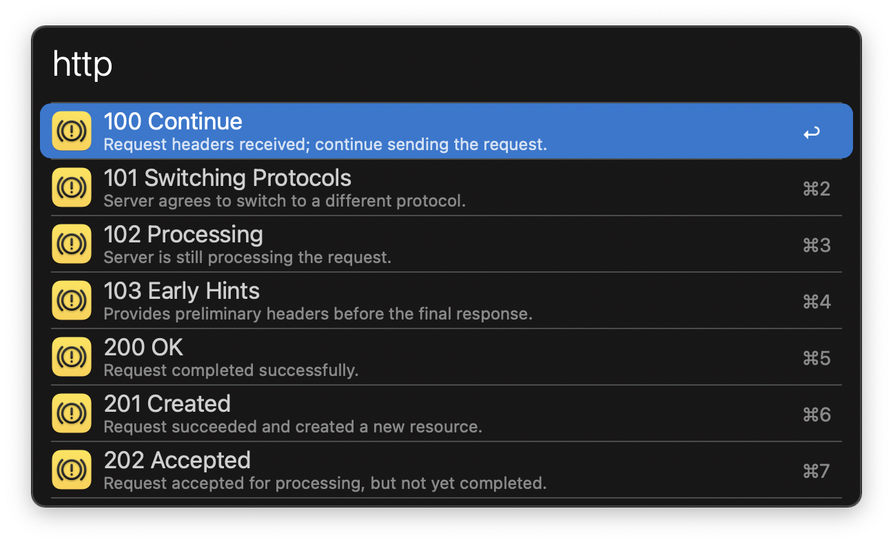

#  HTTP Lookup Alfred Workflow

Look up HTTP status codes with Alfred

[⤓ Download the workflow](https://github.com/iAli/http-lookup-workflow/releases/latest)

## Usage

Look up HTTP status codes and their docs via the `http` keyword.

* <kbd>↩</kbd>: View the code details on `MDN Web Docs`.
* <kbd>⌘</kbd><kbd>↩</kbd>: View the code meme on `HTTP Cats`.
